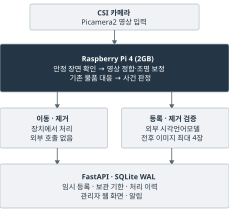
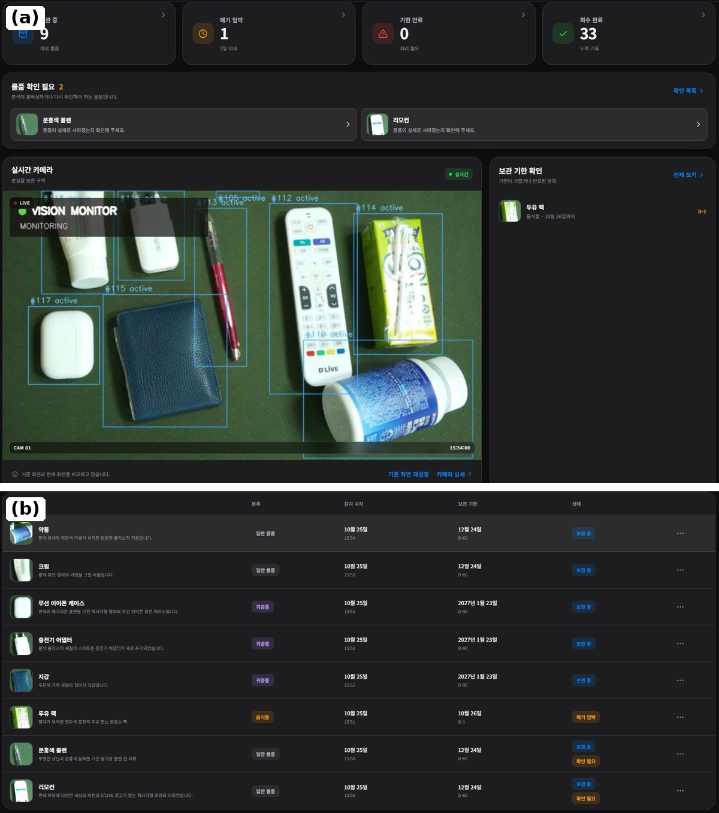
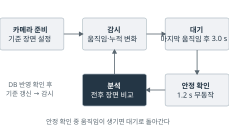
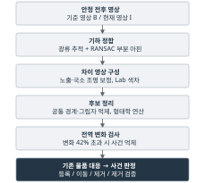
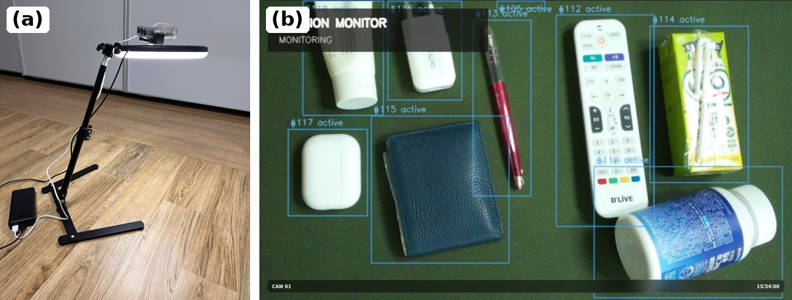
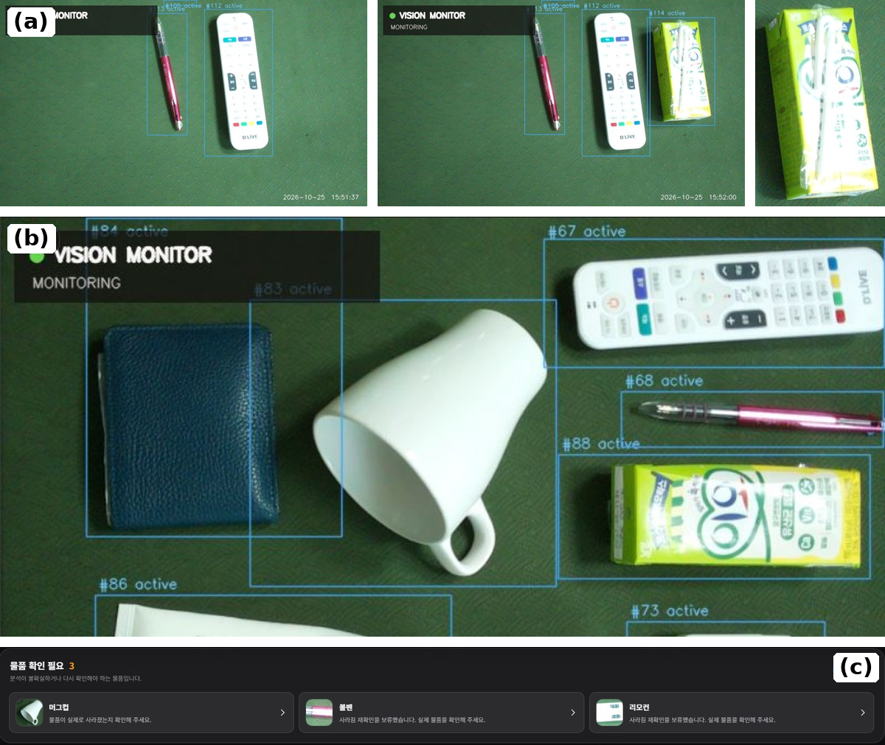

# 저사양 엣지 장치에서의 사건 기반 장면 변화 감지와 선택적 멀티모달 추론을 이용한 분실물 관리 시스템

> 2026-10-11 축소 개정본(JDCS 심사용 원고 기준 약 10쪽 목표). 이중 대괄호는 실험 후 채운다. 표 5–8의 `[[T5]]`–`[[T8]]`은 집계 스크립트가 만든 표로 통째로 교체한다. 결과가 예상과 다르면 요약·고찰·결론 문장을 결과에 맞게 고친다.

An Event-Triggered Scene Change Detection and Selective Multimodal Inference System for Lost-Item Management on a Resource-Constrained Edge Device

## 요약

분실물 보관대를 자동으로 관리하려면 물품의 종류뿐 아니라 물품이 새로 놓이거나 옮겨지고 사라지는 상태 변화를 기록해야 한다. 본 연구는 Raspberry Pi 4(2GB)와 카메라로 보관대의 상태 변화를 감지하고, 필요한 경우에만 외부 시각언어모델로 물품 정보를 보완하는 분실물 관리 시스템 Re:Found를 제안한다. 장치는 움직임이 끝나고 장면이 안정된 뒤에만 전후 영상을 비교하며, 영상 정합과 조명 보정으로 흔들림과 밝기 변화의 영향을 줄이고 기존 물품과의 대응으로 등록·이동·제거를 구분한다. 외부 모델은 새 물품과 판단이 모호한 제거에만 전후 이미지 최대 4장으로 호출하며, 결과는 보관 기한과 처리 이력을 관리하는 웹 서비스에 연결된다. 실제 보관대 환경의 [[N_TRIALS]]회 실험에서 사건 판정 정확도는 [[ACC_OVERALL]]%였고, 조명·그림자 방해 조건 20회 중 오등록은 [[NUISANCE_FP]]건이었다. 외부 모델 호출은 전체 감지 사건의 [[AI_CALL_RATIO]]%에 한정되었으며, 장치의 평균 CPU 사용률은 [[CPU_MEAN]]%, 최고 온도는 [[TEMP_MAX]]°C였다.

주제어: 엣지 컴퓨팅, 장면 변화 감지, 멀티모달 인공지능, 분실물 관리, 라즈베리 파이

## Abstract

Managing a lost-item shelf requires recording not only what an object is but also when it is added, moved, or removed. This paper presents Re:Found, a lost-item management system that detects such state changes with a Raspberry Pi 4 (2 GB) and a camera, and consults an external vision-language model only when necessary. The device compares before-and-after images only after motion has ended and the scene has stabilized. Image alignment and illumination compensation reduce the effects of camera shake and lighting changes, and association with registered items distinguishes additions, moves, and removals. The external model is invoked only for new items and ambiguous removals, with up to four before-and-after images, and its results are linked to a web service that manages retention periods and handling histories. In [[N_TRIALS]] trials on a real storage shelf, the event classification accuracy was [[ACC_OVERALL]]%, and [[NUISANCE_FP]] false registrations occurred in 20 trials with lighting and shadow disturbances. External model calls were limited to [[AI_CALL_RATIO]]% of all detected events, while the device showed an average CPU utilization of [[CPU_MEAN]]% and a maximum temperature of [[TEMP_MAX]]°C.

Keywords: Edge Computing, Scene Change Detection, Multimodal AI, Lost-Item Management, Raspberry Pi

# 1. 서론

## 1-1 연구 배경

학교와 공공시설의 분실물 업무는 물품 접수, 특징 기록, 보관 기한 관리와 반환·폐기 처리로 이루어지며 대부분 담당자의 수작업에 의존한다. 이를 돕기 위해 정하민 등[1]은 사진에서 물품의 분류와 태그를 추출하는 등록·조회 시스템을 제안하였고, 장현상 등[2]은 열차 영상에서 사람과 가방을 추적해 소유 관계를 판단하였다. 양형준과 최규상[3]은 Raspberry Pi 4에서 차량 내부의 전후 이미지를 비교해 분실물 후보를 찾았다. 그러나 담당자가 물품을 놓아두는 고정 보관대에서는 물품이 언제 새로 놓이고, 옮겨지고, 사라졌는지를 지속적으로 기록하는 문제가 남는다.

## 1-2 문제와 접근

보관대를 촬영하는 고정 카메라에서도 조명 변화, 그림자, 미세한 흔들림이 물품 변화와 비슷한 영상 차이를 만든다[4]. 물품을 놓는 손의 움직임과 최종 배치도 구분해야 한다. 또한 모든 프레임에 고성능 객체 탐지나 외부 인공지능 모델을 적용하면 저사양 장치의 연산 자원과 네트워크·비용 부담이 커진다.

본 연구는 분석 단위를 개별 프레임이 아닌 상태 변화 사건으로 바꾼다. 저사양 장치는 움직임이 끝난 안정 장면만 비교하여 등록·이동·제거 사건을 판정하고, 물품의 이름과 분류처럼 의미 이해가 필요한 경우에만 외부 시각언어모델을 호출한다.

## 1-3 연구 기여

본 연구의 기여는 다음과 같다. 첫째, 안정 장면 상태기계, 영상 정합, 조명 보정과 기존 물품 대응을 결합하여 Raspberry Pi 4에서 동작하는 사건 검출 절차를 설계하였다. 둘째, 사건 종류에 따라 외부 모델 호출 여부를 결정하고, 원격 응답 전에 관찰을 먼저 저장하는 선택적 추론 구조를 구현하였다. 셋째, 실제 보관대 실험으로 사건 판정 정확도, 방해 조건의 오등록, 외부 호출 비율과 장치 자원 사용량을 검증하였다.

논문의 구성은 다음과 같다. 2장은 관련 연구, 3장은 시스템 구조, 4장은 사건 검출과 선택적 추론 방법을 설명한다. 5장과 6장은 실험 방법과 결과를, 7장은 결론을 제시한다.

# 2. 관련 연구

## 2-1 장면 변화 감지

배경 차감과 차영상은 물품의 종류를 미리 알지 못해도 변화 영역을 찾을 수 있어 고정 카메라 감시에 널리 쓰인다. Wallflower[4]는 조명 변화와 배경 내 움직임 때문에 배경 유지가 어려워지는 조건을 정리하였고, Zivkovic[5]의 적응형 가우시안 혼합 모델(MOG2)은 화소별 배경 분포를 갱신하여 점진적 변화에 대응한다. 그러나 이러한 전경 후보가 곧 새 물품을 뜻하지는 않으며, 물품이 이동한 경우에는 기존 물품과의 대응이 추가로 필요하다.

## 2-2 선택적 영상 분석과 시각언어모델

엣지 컴퓨팅은 데이터가 발생하는 장치 가까이에서 연산하여 응답성과 네트워크 부담을 개선한다[6]. NoScope[7]는 저비용 차이 검출기로 고비용 신경망 분석이 필요한 프레임을 줄였고, Reducto[8]는 카메라 측의 저수준 특징으로 전송할 프레임을 선별하였다. 한편 BLIP-2[9]와 같은 시각언어모델은 이미지와 언어를 연결해 물체의 종류와 특징을 자연어로 설명할 수 있다. 본 연구는 선별의 단위를 프레임이 아닌 물품 상태 변화 사건으로 정하고, 선택된 사건에만 시각언어모델을 적용한다. 표 1은 관련 연구의 대상과 본 연구의 초점을 비교한다.

**표 1. 관련 연구와 본 연구의 비교 / Table 1. Comparison with related work**

| 연구 | 대상·접근 | 본 연구와의 차이 |
|---|---|---|
| [1] | 사진 분류 기반 등록·조회 | 영상에서 등록 시점을 자동 판단 |
| [2] | 사람·가방 추적과 소유 관계 | 보관대 물품의 상태 변화 기록 |
| [3] | 차량 내부 전후 비교 | 연속 감시 중 등록·이동·제거 구분 |
| [7], [8] | 고비용 분석 전 프레임 선별 | 사건 단위 선별과 의미 추론 결합 |

# 3. 시스템 설계

## 3-1 전체 구조

Re:Found는 그림 1과 같이 엣지 영상 처리, 선택적 의미 추론, 관리 서비스의 세 계층으로 구성된다. Raspberry Pi 4에 연결된 CSI 카메라 영상은 Picamera2[10]로 입력되고, OpenCV 기반 감시 모듈이 움직임과 장면 변화를 판정한다. 영상 수집과 사건 처리를 별도 스레드로 분리하여 데이터베이스 저장이나 네트워크 지연이 영상 수집을 멈추지 않게 하였다. FastAPI 서버는 사건 반영, 관리자 웹 화면과 실시간 미리보기를 제공하고, SQLite WAL[11]에 물품·활동 이력·알림·설정을 저장한다. 외부 의미 추론은 설정에 따라 OpenAI[12] 또는 Gemini[13] API를 사용한다.

**그림 1. Re:Found의 전체 구조 / Fig. 1. Overall architecture of Re:Found**

## 3-2 사건별 처리 정책

로컬 감시 모듈은 표 2의 네 가지 사건을 생성한다. 외부 모델은 의미 정보가 필요한 등록과 판단이 모호한 제거에만 호출하고, 기존 물품으로 식별된 이동과 명확한 제거는 장치에서 처리한다.

**표 2. 사건별 처리 / Table 2. Processing by event type**

| 사건 | 판정 조건 | 외부 모델 | 처리 |
|---|---|---|---|
| 등록 | 기존 물품과 대응되지 않는 새 변화 | 호출 | 임시 등록 후 이름·분류 갱신 |
| 이동 | 기존 물품이 다른 위치에서 재식별 | 없음 | 같은 ID의 위치 갱신 |
| 제거 | 기존 위치가 빈 배경과 일치 | 없음 | 회수 상태로 전환 |
| 제거 검증 | 제거 여부가 모호함 | 호출 | 확신할 때만 회수, 아니면 관리자 확인 |

화면 대부분이 동시에 변하면 조명 전환이나 카메라 충격으로 보고 사건을 만들지 않는다.

## 3-3 저사양 장치를 위한 설계 선택

Raspberry Pi 4 2GB에서 모든 프레임에 딥러닝 객체 탐지기를 실행하면 감시와 웹 서비스를 함께 운영할 여유가 부족하고, 미리 학습한 분류에 없는 다양한 분실물을 다루기도 어렵다. 본 시스템은 학습 모델의 경량화 대신 분석 시점과 대상을 줄이는 방식으로 이 제약에 대응한다. 첫째, 무거운 비교는 움직임이 끝난 안정 장면에서만 수행한다. 둘째, 영상 정합은 폭 360화소로 축소한 영상에서 계산하고, 외부 모델에 보낼 후보 영역만 원본 해상도로 잘라 JPEG 품질 88로 유지한다. 셋째, 관리자 화면의 미리보기는 분석 영상과 분리하여 낮은 해상도와 프레임률로 전송한다. 넷째, 물품의 종류처럼 학습 범위가 넓은 판단은 외부 시각언어모델에 맡기고, 장치는 사건이 언제 어디서 일어났는지를 판단한다.

## 3-4 관리 기능

관리자 웹 화면은 그림 2와 같이 실시간 카메라 영상, 보관 물품 목록, 확인 필요 물품과 활동 이력을 제공한다. 등록된 물품은 보관 중, 기한 임박, 회수, 폐기 상태로 관리되며 분류별 기본 보관 기한은 귀중품 90일, 일반 60일, 음식 1일이다. 이 기한은 법정 기간이 아니라 본 시스템의 운영 정책이며 관리자가 물품별로 수정할 수 있다. 기한이 임박하면 관리자에게 전자우편 알림을 보내고, 관리자는 물품 정보 수정, 회수·폐기·복원, 감지 제외를 처리한다. 영상에서 사라진 물품의 회수 처리는 시스템상의 상태 전환이며 실제 소유자 반환을 증명하지는 않는다.

**그림 2. 관리자 웹 화면 / Fig. 2. Administrator web interface**

# 4. 사건 검출과 선택적 추론

## 4-1 안정 장면 상태기계

감시 모듈은 그림 3과 같이 카메라 준비, 감시, 대기, 안정 확인, 분석의 다섯 상태로 동작한다. 감시 중 움직임이 발생하면 대기 상태로 전이하고, 마지막 움직임 이후 3.0초가 지나면 1.2초 동안 움직임이 없는지 확인한다. 장면이 안정된 경우에만 기준 영상과 현재 영상을 비교하므로, 물품을 놓는 손이나 이동 중인 물품을 분석할 가능성이 줄어든다. 천천히 놓인 물품처럼 인접 프레임 차이가 작은 경우를 위해 기준 장면과의 누적 변화도 낮은 빈도로 검사한다. 분석 결과가 데이터베이스에 반영된 것을 확인한 뒤 현재 안정 영상을 새 기준으로 삼으며, 저장에 실패하면 기준을 유지하고 다시 시도한다.

**그림 3. 안정 장면 사건 검출의 상태 전이 / Fig. 3. State transitions for stable-scene event detection**

## 4-2 영상 정합과 조명 보정

미세한 카메라 흔들림을 보정하기 위해 기준 영상의 Shi–Tomasi 코너[14]를 Lucas–Kanade 광류[15]로 현재 영상까지 추적하고, 역방향 추적 오차가 작은 대응점만 사용한다. 대응점이 화면에 고르게 분포하면 RANSAC[16]으로 부분 아핀 변환을 추정하여 현재 영상을 기준 좌표계로 변환한다.

\[
F^{*}=\arg\max_F \sum_i \mathbf{1}\!\left(\lVert p'_i-Fp_i\rVert_2\leq\tau\right)
\tag{1}
\]

여기서 \(p_i\)와 \(p'_i\)는 기준 및 현재 영상의 대응점, \(\tau\)는 허용 오차이다. 이동·회전·크기 변화가 상한을 넘는 변환은 거부하며, 이 경우 제한된 평행이동 보정만 시도한다.

정합된 두 영상의 휘도 차 \(s(x)\)에서 중앙값 \(m\)을 빼 전체 노출 변화를 보정하고, 넓은 가우시안 평활로 구한 국소 조명 성분 \(\ell(x)\)을 추가로 뺀다. 국소 보정이 차이를 오히려 키우지 않도록 식 (2)의 작은 값을 사용하고, 바닥과 밝기가 비슷한 색 물품을 놓치지 않도록 Lab 색공간의 색차를 함께 사용한다.

\[
D(x)=\max\left(\min\left(|s(x)-m-\ell(x)|,\,|s(x)-m|\right),\,|\Delta a(x)|,\,|\Delta b(x)|\right)
\tag{2}
\]

초점 변화와 미세 진동은 기존 물체의 윤곽 주변에 띠 모양의 차이를 남긴다. 이를 줄이기 위해 두 영상에서 함께 나타나는 경계 화소를 변화 후보에서 제외한다. 이후 \(D(x)\)를 임계값 24로 이진화하고 3×3 열림, 9×9 닫힘, 5×5 팽창을 차례로 적용한다. 연결 성분은 면적과 밀도에 따라 일반형, 작은 조밀형, 긴 세장형으로 나누어 걸러 내고 가까운 상자를 병합하며, 최소 면적은 1,800화소이다. 변화 영역이 화면의 42%를 넘으면 전역 변화로 보고 사건을 억제하며, 테두리의 가는 변화와 색차가 작은 그림자 후보도 제외한다. 그림 4는 이 절차를 나타낸다.

**그림 4. 변화 후보 생성과 사건 판정 절차 / Fig. 4. Candidate generation and event decision**

## 4-3 기존 물품 대응과 사건 판정

데이터베이스의 보관 중 물품은 등록 당시의 위치 상자, 물품 이미지와 물품이 놓이기 전의 빈 배경 이미지를 가진다. 변화 후보가 기존 물품의 위치와 겹치고 그 영역이 저장된 빈 배경과 충분히 유사하면 제거로 판정한다. 휴대전화 화면이 켜진 경우처럼 물품 내부의 외형만 바뀌었거나 근거가 경계값에 가까우면 자동으로 회수하지 않고 제거 검증으로 보낸다.

기존 위치의 변화와 새 위치의 후보가 함께 나타나면 같은 물품의 이동 여부를 확인한다. 템플릿 상관도와 색상 유사도를 먼저 비교하고, 크기나 배경이 달라 판단이 어려우면 ORB 특징[17] 대응으로 재검증한다. 이동으로 판정되면 새 물품을 만들지 않고 기존 ID의 위치와 참조 이미지를 갱신한다. 어떤 기존 물품과도 대응되지 않는 후보는 등록 사건이 된다.

## 4-4 선택적 멀티모달 추론

등록과 제거 검증 사건에서는 후보 영역의 전후 확대 이미지 2장과 후보 상자를 표시한 전후 전체 장면 2장, 최대 4장을 외부 모델에 보낸다. 확대 이미지는 물품의 종류와 재질을, 전체 장면은 변화 방향과 주변 맥락을 판단하는 데 쓰인다. 모델에는 표 3의 항목을 JSON 스키마 형식으로 응답하도록 요청하고, 전체 장면과 확대 이미지의 결론이 다르거나 새 물품이 분명하지 않으면 불확실로 답하게 한다. 일반 물품이라도 추정 가격이 10만 원 이상이면 귀중품으로 분류한다.

**표 3. 외부 모델 응답 항목 / Table 3. Fields of the external model response**

| 항목 | 내용 |
|---|---|
| action | 등록, 제거, 불확실 중 하나 |
| name, description | 물품 이름과 색상·재질 등 특징 |
| category | 귀중품, 일반, 음식 중 하나 |
| estimated_value_krw | 추정 가격(원) |
| confidence | 판단 신뢰도(0–1) |

등록 사건은 원격 요청 전에 물품 이미지와 함께 '분석 중' 상태로 먼저 저장한다. 따라서 네트워크 오류, 응답 지연, 형식 오류나 낮은 신뢰도가 발생해도 관찰 기록은 삭제되지 않고 관리자 확인 대상으로 남는다. 제거 검증은 모델이 신뢰도 0.5 이상으로 제거를 판단한 경우에만 회수 처리하며, 응답을 기다리는 동안 물품이 이동하거나 관리자가 상태를 바꾸었다면 늦게 도착한 응답을 적용하지 않는다.

## 4-5 전체 처리 절차

알고리즘 1은 하나의 안정 장면에서 수행하는 전체 처리를 요약한 것이다.

**알고리즘 1. 안정 장면 기반 사건 처리 / Algorithm 1. Event processing over stable scenes**

1. 카메라 준비 후 안정 장면을 기준 영상 B로 정한다.
2. 인접 프레임 차이와 B와의 누적 변화로 움직임을 감시한다.
3. 마지막 움직임 후 3.0초 대기와 1.2초 무동작을 만족하면 현재 영상 I를 확정한다.
4. I를 B에 정합하고 조명 보정과 색차로 차이 영상 D를 만든다.
5. 공통 경계와 그림자를 억제하고 후보 상자를 만든다. 변화가 화면의 42%를 넘으면 사건을 만들지 않는다.
6. 후보를 기존 물품과 대응하여 이동, 제거, 제거 검증, 등록을 판정한다.
7. 이동과 제거는 기존 ID에 바로 반영한다.
8. 등록은 임시 저장한 뒤, 제거 검증은 기존 상태를 유지한 채 외부 모델을 호출한다.
9. 사건이 데이터베이스에 반영되면 B를 I로 갱신하고 감시로 돌아간다.

# 5. 구현 및 실험 방법

## 5-1 구현 환경

표 4는 실험 장치와 주요 설정이다. 영상은 1280×720, 초당 10프레임으로 입력하고 감시 모듈은 초당 최대 7프레임을 분석한다. 웹 미리보기는 분석과 별도로 폭 800화소, 초당 5프레임으로 전송한다. 관리자는 Windows 노트북의 모바일 핫스팟에 연결된 Pi에 SSH 터널로 접속해 웹 화면을 사용하였다.

**표 4. 실험 장치와 주요 설정 / Table 4. Experimental setup and main parameters**

| 항목 | 내용 |
|---|---|
| 장치 | Raspberry Pi 4 Model B 2GB, [[EQUIP_STORAGE]], [[EQUIP_COOLING]] |
| 운영체제 | Debian 13 기반 Raspberry Pi OS 64비트, 커널 6.18 |
| 카메라 | OV5647 CSI 카메라, [[EQUIP_CAMERA_GEOMETRY]] |
| 소프트웨어 | Python 3.13, OpenCV 4.10, Picamera2 0.3, FastAPI 0.141 |
| 영상 입력·분석 | 1280×720, 10 fps 입력, 최대 7 fps 분석 |
| 대기·안정 확인 | 3.0 s / 1.2 s |
| 정합 분석 폭 | 360 pixel |
| 외부 모델 | [[VLM_MODEL_DATE]] |
| 네트워크 | [[NETWORK_CONDITION]] |

## 5-2 실험 절차

실험은 [[EXPERIMENT_DATE_PLACE]]에서 책상 위 보관대를 대상으로 수행하였다. 물품은 귀중품, 일반 물품, 음식을 포함한 [[OBJECT_LIST]]의 10종이다. 각 실험 전에 모든 기록을 초기화하고, 한 행동 후 화면에 결과가 반영될 때까지 기다린 뒤 다음 행동을 수행하였다.

일반 조건에서는 10종을 하나씩 놓는 등록, 놓인 물품을 다른 위치로 옮기는 이동, 하나씩 치우는 제거를 차례로 수행하고 이 과정을 2회 반복하여 사건 종류별 20회를 얻었다. 여러 물품이 함께 놓인 상태에서 이동과 제거가 일어나므로 기존 물품과의 대응도 함께 평가된다. 물품 변화가 없는 조건으로는 손을 보관대 위에 넣었다 빼는 동작 20회, 실내 조명을 끄고 켜는 조명 변화 10회, 사람이 옆에 서서 그림자를 만드는 그림자 조건 10회를 수행하였다. 전체 시도는 100회이다. 이와 별도로 물품을 둔 상태에서 [[IDLE_HOURS]]시간 동안 사람의 개입 없이 감시하여 잘못 생성된 사건을 기록하였다.

시도마다 수행한 행동을 정답으로 하고, 관리자 화면에 나타난 결과를 등록·이동·제거·확인 필요·반응 없음 중 하나로 기록하였다. 등록 사건에서는 외부 모델이 붙인 이름과 분류가 실제 물품에 맞는지를 함께 기록하였다.

## 5-3 평가 지표

사건 판정은 정답 행동과 시스템 결과의 혼동행렬로 정리하고, 정확도와 사건 종류별 정밀도, 재현율, F1 점수를 계산한다. 무변화 시도에서 등록·이동·제거가 나타나면 오탐으로 센다. 정확도에는 Wilson 95% 신뢰구간[18]을 함께 제시한다.

외부 모델 평가는 호출 비율, 인식 정확도와 처리 시간으로 한다. 호출 비율은 실험 중 감지된 전체 사건 중 외부 모델을 호출한 사건의 비율이고, 인식 정확도는 성공한 등록 사건 중 이름과 분류가 맞은 비율이다. 처리 시간은 데이터베이스의 활동 기록에서 임시 등록 시각부터 인식 결과 반영 시각까지로 계산한다. 장치 자원은 실험 중 1초 간격으로 CPU 사용률, 메모리, SoC 온도를 기록하고, 시스템 상태 API로 실제 분석 프레임률과 프레임당 처리 시간을 기록한다.

# 6. 실험 결과 및 고찰

## 6-1 사건 판정 결과

표 5는 100회 시도의 혼동행렬이고, 표 6은 사건 종류별 성능이다. 전체 정확도는 [[ACC_OVERALL]]%(95% 신뢰구간 [[ACC_CI]])였고 세 사건 종류의 평균 F1 점수는 [[MACRO_F1]]였다. [[MAIN_ERROR]]

**표 5. 사건 판정 혼동행렬 / Table 5. Confusion matrix of event decisions**

| 정답＼결과 | 등록 | 이동 | 제거 | 확인 필요 | 반응 없음 |
|---|---|---|---|---|---|
| 등록(20) | [[T5]] | [[T5]] | [[T5]] | [[T5]] | [[T5]] |
| 이동(20) | [[T5]] | [[T5]] | [[T5]] | [[T5]] | [[T5]] |
| 제거(20) | [[T5]] | [[T5]] | [[T5]] | [[T5]] | [[T5]] |
| 무변화(40) | [[T5]] | [[T5]] | [[T5]] | [[T5]] | [[T5]] |

**표 6. 사건 종류별 성능 / Table 6. Performance by event type**

| 사건 | 정밀도 | 재현율 | F1 |
|---|---|---|---|
| 등록 | [[T6]] | [[T6]] | [[T6]] |
| 이동 | [[T6]] | [[T6]] | [[T6]] |
| 제거 | [[T6]] | [[T6]] | [[T6]] |
| 평균 | [[T6]] | [[T6]] | [[T6]] |

물품 변화가 없는 조건에서 오탐은 손 동작 20회 중 [[HAND_FP]]건, 조명 변화 10회 중 [[LIGHT_FP]]건, 그림자 10회 중 [[SHADOW_FP]]건이었다. 조명 전환과 그림자는 넓은 영역의 화소값을 바꾸므로 단순 차영상에서는 변화로 검출된다. 제안 방법에서는 노출 보정, 그림자 후보 제거와 전역 변화 억제가 이러한 차이를 물품 사건에서 제외하는 역할을 한다. [[IDLE_HOURS]]시간 무인 감시에서는 잘못된 사건이 [[IDLE_FP]]건 발생하였다.

## 6-2 외부 모델 호출과 인식 결과

표 7은 외부 모델의 호출과 인식 결과이다. 실험 중 감지된 사건 중 외부 모델 호출은 [[AI_CALL_RATIO]]%였으며, 이동과 명확한 제거는 원격 요청 없이 처리되었다. 같은 시간 동안 감시 모듈이 분석한 [[FRAMES_PROCESSED]]프레임과 비교하면, 프레임마다 외부 모델을 호출하는 방식에 비해 요청 수가 크게 줄어든다. 등록 물품의 이름 정확도는 [[AI_NAME_ACC]]%, 분류 정확도는 [[AI_CATEGORY_ACC]]%였다.

**표 7. 외부 모델 호출과 인식 결과 / Table 7. External model calls and recognition results**

| 항목 | 값 |
|---|---|
| 전체 감지 사건 / 외부 호출(등록·제거 검증) | [[T7]] |
| 호출 비율 | [[T7]] |
| 이름 / 분류 정확도 | [[T7]] |
| 관리자 확인 필요 비율 | [[T7]] |
| 처리 시간 중앙값 / 최대 | [[T7]] |

## 6-3 장치 자원과 처리 시간

표 8은 실험 중 Raspberry Pi의 자원 사용량이다. 평균 CPU 사용률은 [[CPU_MEAN]]%, 서비스 프로세스의 최대 메모리는 [[RSS_MAX]]MiB, 최고 온도는 [[TEMP_MAX]]°C였다. 실제 분석 프레임률은 평균 [[FPS_MEAN]] fps, 프레임당 처리 시간은 평균 [[PROC_MS_MEAN]]ms였다. 사건 등록은 안정 확인을 위해 마지막 움직임 후 최소 4.2초를 기다리므로, 사용자가 느끼는 등록 시간은 이 대기와 외부 모델 처리 시간의 합으로 나타난다.

**표 8. Raspberry Pi 자원 사용량 / Table 8. Resource usage on Raspberry Pi**

| 항목 | 평균 | 최대 |
|---|---|---|
| 장치 CPU 사용률(%) | [[T8]] | [[T8]] |
| 서비스 메모리(MiB) | [[T8]] | [[T8]] |
| SoC 온도(°C) | [[T8]] | [[T8]] |
| 분석 프레임률(fps) | [[T8]] | [[T8]] |
| 프레임 처리 시간(ms) | [[T8]] | [[T8]] |

## 6-4 실패 사례와 한계

그림 5는 실험 환경이고, 그림 6은 판정 결과의 예이다. 주요 실패 사례는 [[FAIL_CASES]]였다.

**그림 5. 실험 환경 / Fig. 5. Experimental setup**

**그림 6. 사건 판정의 성공과 실패 예 / Fig. 6. Examples of successful and failed decisions**

본 실험은 한 장소, 한 대의 카메라와 10종의 물품으로 수행하였으므로 다른 설치 높이, 조명과 배경으로 결과를 바로 일반화하기 어렵다. 안정 장면만 비교하므로 물품을 들었다가 같은 자리에 다시 놓은 행동은 기록되지 않으며, 여러 물품이 동시에 움직이는 경우는 평가하지 않았다. 외부 모델의 응답은 모델 갱신에 따라 달라질 수 있고, 전체 장면 이미지에 사람이 포함될 수 있으므로 실제 운영에서는 촬영 범위와 개인정보 보호 절차가 필요하다.

# 7. 결론

본 논문은 Raspberry Pi 4와 고정 카메라로 분실물 보관대의 상태 변화를 감지하고, 필요한 사건에만 외부 시각언어모델을 적용하는 분실물 관리 시스템 Re:Found를 제안하였다. 안정 장면 상태기계, 영상 정합, 조명 보정과 기존 물품 대응으로 등록·이동·제거를 구분하고, 새 물품과 모호한 제거에만 전후 이미지 최대 4장을 보내 의미 정보를 보완하였다. 원격 응답 전에 관찰을 저장하여 외부 오류에도 기록이 보존되도록 하였다.

실제 보관대 실험에서 사건 판정 정확도는 [[ACC_OVERALL]]%였고, 외부 모델 호출은 감지 사건의 [[AI_CALL_RATIO]]%에 한정되었다. 장치는 평균 CPU [[CPU_MEAN]]%, 최고 온도 [[TEMP_MAX]]°C에서 감시와 관리 서비스를 함께 운영하였다. 향후에는 여러 설치 환경과 동시 다중 물품 조건으로 평가를 확장하고, 기존 배경 차감 방법과의 비교를 수행할 계획이다.

# 참고문헌

[1] H. Jeong, H. Yoo, T. You, Y. Kim, and Y. H. Ahn, “Lost and Found Registration and Inquiry Management System for User-dependent Interface using Automatic Image Classification and Ranking System based on Deep Learning,” Journal of Convergence Security, Vol. 18, No. 4, pp. 19-25, 2018. https://www.kci.go.kr/kciportal/ci/sereArticleSearch/ciSereArtiView.kci?sereArticleSearchBean.artiId=ART002401814

[2] H. S. Jang et al., “Implementation of a Deep OC-SORT based Multi-Object Tracking and Matching Algorithm for Managing Lost Items and Owners in Trains,” Journal of Korean Institute of Information Technology, Vol. 23, No. 2, pp. 165-176, 2025. https://doi.org/10.14801/jkiit.2025.23.2.165

[3] 양형준, 최규상, “히스토그램 평활화 및 윤곽선 필터링을 활용한 차량 내 분실물 감지 시스템,” 한국정보기술학회 하계종합학술대회 논문집, pp. 1221-1224, 2025. https://www.dbpia.co.kr/journal/articleDetail?nodeId=NODE12288829

[4] K. Toyama, J. Krumm, B. Brumitt, and B. Meyers, “Wallflower: Principles and Practice of Background Maintenance,” Proceedings of ICCV, Vol. 1, pp. 255-261, 1999. https://doi.org/10.1109/ICCV.1999.791228

[5] Z. Zivkovic, “Improved Adaptive Gaussian Mixture Model for Background Subtraction,” Proceedings of the 17th International Conference on Pattern Recognition, Vol. 2, pp. 28-31, 2004. https://doi.org/10.1109/ICPR.2004.1333992

[6] M. Satyanarayanan, “The Emergence of Edge Computing,” Computer, Vol. 50, No. 1, pp. 30-39, 2017. https://doi.org/10.1109/MC.2017.9

[7] D. Kang, J. Emmons, F. Abuzaid, P. Bailis, and M. Zaharia, “NoScope: Optimizing Neural Network Queries over Video at Scale,” Proceedings of the VLDB Endowment, Vol. 10, No. 11, pp. 1586-1597, 2017. https://doi.org/10.14778/3137628.3137664

[8] Y. Li, A. Padmanabhan, P. Zhao, Y. Wang, G. H. Xu, and R. Netravali, “Reducto: On-Camera Filtering for Resource-Efficient Real-Time Video Analytics,” Proceedings of ACM SIGCOMM, pp. 359-376, 2020. https://doi.org/10.1145/3387514.3405874

[9] J. Li, D. Li, S. Savarese, and S. Hoi, “BLIP-2: Bootstrapping Language-Image Pre-training with Frozen Image Encoders and Large Language Models,” Proceedings of ICML, PMLR, Vol. 202, pp. 19730-19742, 2023. https://proceedings.mlr.press/v202/li23q.html

[10] Raspberry Pi Ltd., “The Picamera2 Library,” [Online]. Available: https://datasheets.raspberrypi.com/camera/picamera2-manual.pdf (accessed Sep. 15, 2026).

[11] SQLite, “Write-Ahead Logging,” [Online]. Available: https://www.sqlite.org/wal.html (accessed Sep. 15, 2026).

[12] OpenAI, “Create a Model Response,” [Online]. Available: https://developers.openai.com/api/reference/cli/resources/responses/methods/create (accessed Sep. 15, 2026).

[13] Google, “Image Understanding,” Gemini API Documentation, [Online]. Available: https://ai.google.dev/gemini-api/docs/image-understanding (accessed Sep. 15, 2026).

[14] J. Shi and C. Tomasi, “Good Features to Track,” Proceedings of the IEEE Conference on Computer Vision and Pattern Recognition, pp. 593-600, 1994. https://doi.org/10.1109/CVPR.1994.323794

[15] B. D. Lucas and T. Kanade, “An Iterative Image Registration Technique with an Application to Stereo Vision,” Proceedings of the 7th International Joint Conference on Artificial Intelligence, pp. 674-679, 1981. https://publications.ri.cmu.edu/an-iterative-image-registration-technique-with-an-application-to-stereo-vision-ijcai

[16] M. A. Fischler and R. C. Bolles, “Random Sample Consensus: A Paradigm for Model Fitting with Applications to Image Analysis and Automated Cartography,” Communications of the ACM, Vol. 24, No. 6, pp. 381-395, 1981. https://doi.org/10.1145/358669.358692

[17] E. Rublee, V. Rabaud, K. Konolige, and G. Bradski, “ORB: An Efficient Alternative to SIFT or SURF,” 2011 International Conference on Computer Vision, pp. 2564-2571, 2011. https://doi.org/10.1109/ICCV.2011.6126544

[18] E. B. Wilson, “Probable Inference, the Law of Succession, and Statistical Inference,” Journal of the American Statistical Association, Vol. 22, No. 158, pp. 209-212, 1927. https://doi.org/10.1080/01621459.1927.10502953
