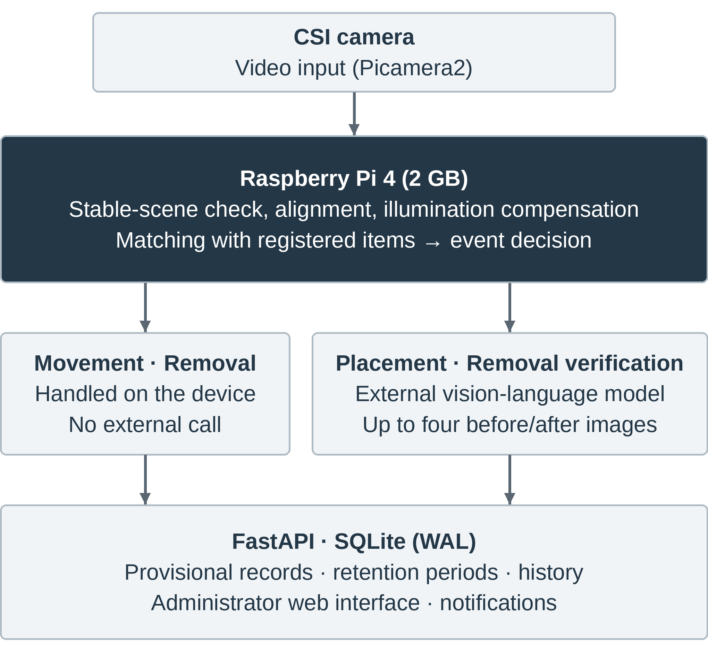
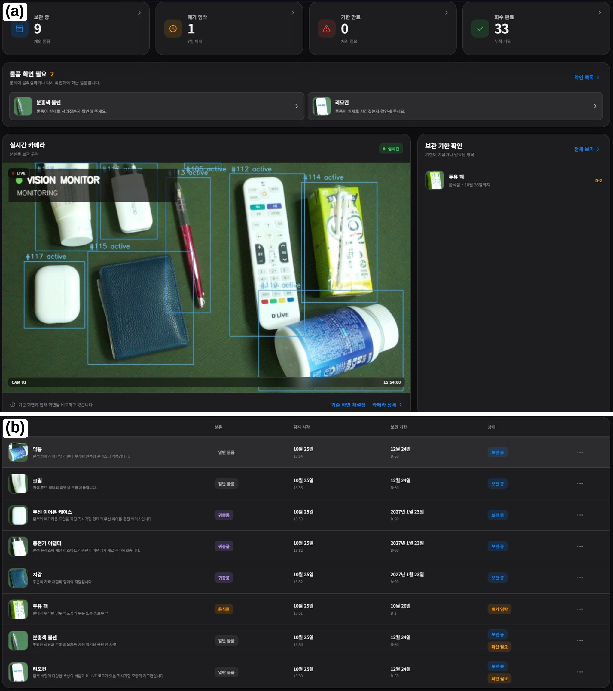
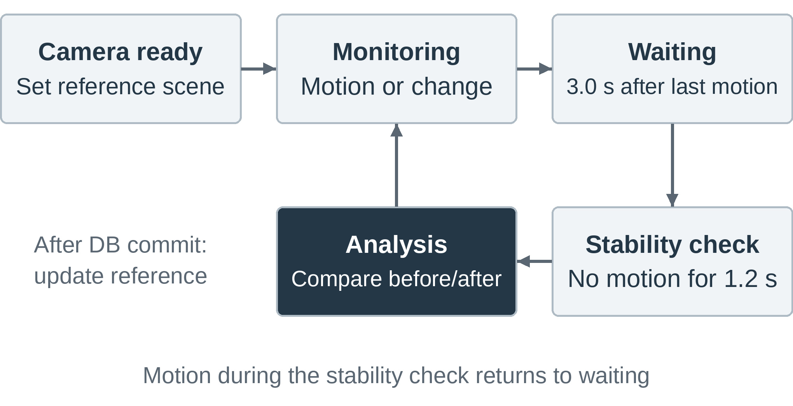
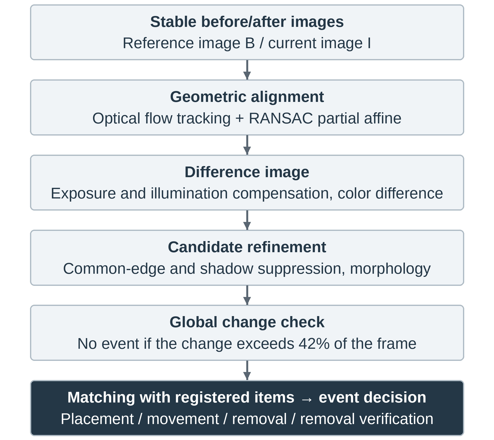
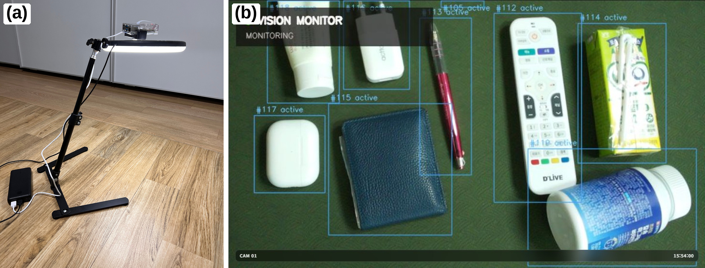
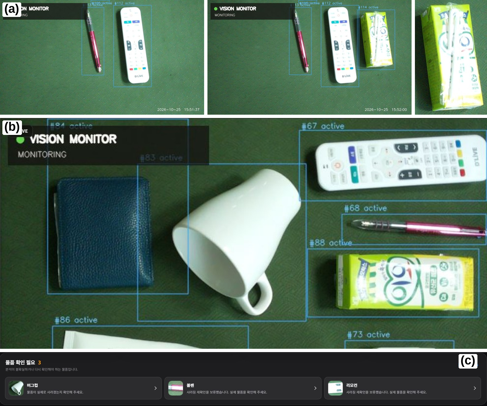

# 저사양 엣지 장치와 시각언어모델을 이용한 사건 기반 분실물 관리 시스템의 설계와 구현

> 2026-11-11 실천공학교육논문지(JPEE) 투고용 원고(심사용, 저자 정보 없음). 학회의 투고 규정(2025-03-01)과 국문 워드 양식에 맞췄다: 1단, 장 번호 I.·A.·1), 국문 요약 500자 이내, 영문 요약 200단어 이내, Key Words 5개, 표와 참고문헌은 영문, 그림과 표는 참고문헌 뒤. 숫자는 JDCS 원고와 같고 원본은 [10/25 실험 결과](../RESULTS_2026-10-25.md)다. 제출 파일은 이 원고로 만든 [워드 파일](../REFOUND_JPEE_MANUSCRIPT.docx)이다. **JDCS 원고와 같은 연구이므로 두 학술지 중 한 곳에만 투고한다.**

Design and Implementation of an Event-Based Lost-Item Management System Using a Low-Cost Edge Device and a Vision-Language Model

## 요 약

분실물 보관대를 자동으로 관리하려면 물품이 놓이고 옮겨지고 치워지는 상태 변화를 기록해야 한다. 본 논문은 학부 캡스톤디자인 과정에서 개발한 분실물 관리 시스템의 설계와 구현, 실험 결과를 제시한다. 시스템은 Raspberry Pi 4(2 GB)와 카메라로 보관대의 상태 변화를 사건 단위로 감지하고, 의미 판단이 필요한 사건에만 외부 시각언어모델을 호출한다. 장치는 장면이 안정된 뒤에만 영상 정합과 조명 보정을 거쳐 전후 영상을 비교하고, 기존 물품과의 대응으로 등록·이동·제거를 구분한다. 물품 10종으로 각 동작을 10회씩 반복한 실험에서 얇은 줄이어폰은 등록되지 않았고, 나머지 9종의 동작 270회 중 244회(90.4%)가 올바르게 기록되었다. 등록과 제거는 93.3%, 96.7%, 이동은 81.1%였다. 외부 모델의 이름·분류 정확도는 95.2%였고, 손을 뗀 뒤 이름이 표시되기까지 중앙값 7.8초가 걸렸다. 초기 계획에서 최종 구현으로 설계를 바꾼 과정과 근거도 정리하였다.

## ABSTRACT

Managing a lost-and-found shelf requires recording when items are placed, moved, and taken away. This paper presents the design, implementation, and experimental results of a lost-item management system developed in an undergraduate capstone design course. The system detects state changes of the shelf as events on a Raspberry Pi 4 (2 GB) with a camera and calls an external vision-language model only for events that need semantic judgment. The device compares before-and-after images only after the scene has stabilized, using image alignment and illumination compensation, and distinguishes placement, movement, and removal by matching changes with registered items. In an experiment with ten items and ten repetitions of each action, a thin wired earphone was never registered, while 244 of 270 actions on the other nine items (90.4%) were recorded correctly. Placement and removal reached 93.3% and 96.7%, and movement reached 81.1%. The model named and categorized 95.2% of the registered items correctly, and the median time from the hand action to the displayed name was 7.8 s. The design changes from the initial plan to the final implementation and their reasons are also described.

Key Words : Capstone design; Edge computing; Raspberry Pi; Scene change detection; Vision-language model.

# I. 서 론

학교와 공공시설의 분실물 업무는 물품 접수, 특징 기록, 보관 기한 관리와 반환·폐기 처리로 이루어지며 대부분 담당자의 수작업에 의존한다. 이를 돕기 위해 사진에서 물품의 분류와 태그를 추출하는 등록·조회 시스템[1], 열차 영상에서 사람과 가방을 추적해 소유 관계를 판단하는 방법[2], Raspberry Pi 4에서 차량 내부의 전후 이미지를 비교해 분실물 후보를 찾는 방법[3]이 제안되었다. 그러나 담당자가 물품을 놓아두는 고정 보관대에서는 물품이 언제 새로 놓이고, 옮겨지고, 치워졌는지를 지속적으로 기록하는 문제가 남는다. 이 기록이 있어야 보관 기한과 처리 이력을 사람의 입력 없이 이어서 관리할 수 있다.

보관대를 비추는 고정 카메라에서도 조명 변화, 그림자, 미세한 흔들림과 카메라의 자동 노출·초점 조정이 물품 변화와 비슷한 영상 차이를 만든다[4]. 물품을 놓는 손의 움직임과 최종 배치를 구분해야 하며, 옮겨진 물품을 새 물품으로 중복 등록하지 않아야 한다. 또한 모든 프레임에 고성능 객체 탐지나 외부 인공지능 모델을 적용하면 저사양 장치의 연산 자원과 네트워크·비용 부담이 커진다.

본 논문은 학부 캡스톤디자인 과정에서 이 문제를 다룬 시스템의 개발 사례를 보고한다. 분석 단위를 개별 프레임이 아닌 상태 변화 사건으로 정하여, 저사양 장치는 움직임이 끝난 안정 장면만 비교해 등록·이동·제거 사건을 판정하고, 물품의 이름과 분류처럼 의미 이해가 필요한 경우에만 외부 시각언어모델을 호출한다. 외부 모델의 응답은 늦거나 틀릴 수 있으므로, 장치는 응답을 기다리기 전에 관찰을 먼저 저장하고 기준에 맞지 않는 응답은 관리자 확인 대상으로 남긴다.

본 논문의 기여는 다음과 같다. 첫째, 안정 장면 상태기계, 영상 정합, 조명 보정과 기존 물품 대응을 결합하여 Raspberry Pi 4에서 초당 약 6프레임으로 동작하는 사건 검출 절차를 설계·구현하였다. 둘째, 사건 종류에 따라 외부 모델의 호출 여부를 정하고, 관찰을 먼저 저장한 뒤 정해진 응답 형식과 신뢰도 기준을 통과한 결과만 반영하는 선택적 추론 구조를 구현하였다. 셋째, 실제 보관대에서 물품 10종의 등록·이동·제거를 각 10회 반복하여 동작별 기록 성공률, 외부 모델의 인식 정확도와 처리 시간을 측정하고 실패 유형을 분석하였다. 넷째, 초기 계획에서 최종 구현에 이르기까지 장치의 제약에 따라 설계를 바꾼 과정과 근거를 정리하여, 저사양 장치 기반 프로젝트의 설계 판단에 참고할 수 있게 하였다.

# II. 관련 연구

## A. 장면 변화 감지

배경 차감과 차영상은 물품의 종류를 미리 알지 못해도 변화 영역을 찾을 수 있어 고정 카메라 감시에 널리 쓰인다. Wallflower[4]는 조명 변화와 배경 내 움직임 때문에 배경 유지가 어려워지는 조건을 정리하였고, 적응형 가우시안 혼합 모델 (GMM; Gaussian mixture model)[5]은 화소별 배경 분포를 갱신하여 점진적 변화에 대응한다. 그러나 이러한 전경 후보가 곧 새 물품을 뜻하지는 않으며, 물품이 이동한 경우에는 기존 물품과의 대응이 추가로 필요하다.

## B. 선택적 영상 분석과 시각언어모델

엣지 컴퓨팅은 데이터가 발생하는 장치 가까이에서 연산하여 응답성과 네트워크 부담을 개선한다[6]. NoScope[7]는 저비용 차이 검출기로 고비용 신경망 분석이 필요한 프레임을 줄였고, Reducto[8]는 카메라 측의 저수준 특징으로 전송할 프레임을 선별하였다. 한편 BLIP-2[9]와 같은 시각언어모델은 이미지와 언어를 연결해 물체의 종류와 특징을 자연어로 설명할 수 있다. 본 연구는 선별의 단위를 프레임이 아닌 물품 상태 변화 사건으로 정하고, 선택된 사건에만 시각언어모델을 적용한다.

## C. Raspberry Pi 기반 시스템 개발 사례

Raspberry Pi는 가격이 낮고 범용 운영체제와 카메라·센서 연결을 함께 제공하여 현장 문제를 다루는 시스템 개발과 프로젝트 교육에 널리 쓰인다. 소규모 식품 제조 현장의 기록 관리를 위해 Raspberry Pi 엣지 장치와 클라우드 서비스를 결합하고, 네트워크가 끊겨도 자료가 유실되지 않도록 장치에 임시 저장 구조를 둔 시스템이 보고되었다[10]. 아두이노와 Raspberry Pi 4로 벼 생육 환경 자료를 수집하고 실시간으로 확인하는 시스템[11], Raspberry Pi 실습 장비로 실습과 프로젝트를 통합한 사물인터넷 교육 사례[12]도 있다. 본 연구는 같은 장치에서 센서 값이 아닌 카메라 영상의 변화를 사건으로 만들고, 외부 모델의 지연과 오류를 전제로 기록을 먼저 보존하는 구조를 다룬다는 점에서 이들과 구별된다.

# III. 시스템 설계

## A. 개발 과정과 설계 변경

본 시스템은 학부 캡스톤디자인 교과목에서 두 학기에 걸쳐 개발하였다. 초기 기획에서는 Raspberry Pi 5에서 객체 탐지 모델과 직접 학습한 분류 모델, 로컬 언어모델을 실행하고 결과를 클라우드 데이터베이스에 저장하는 구조를 계획하였다. 그러나 실제 배포 장치가 메모리 2 GB의 Raspberry Pi 4로 정해졌고, 분실물은 미리 학습한 분류로 한정하기 어렵다고 판단하여 표 1과 같이 설계를 바꾸었다. 변경의 원칙은 학습 모델을 가볍게 만드는 대신 분석하는 시점과 대상을 줄이고, 장치는 사건이 언제 어디서 일어났는지를, 외부 모델은 그것이 무엇인지를 판단하도록 역할을 나누는 것이었다.

## B. 전체 구조

시스템은 그림 1과 같이 엣지 영상 처리, 선택적 의미 추론, 관리 서비스의 세 계층으로 구성된다. Raspberry Pi 4에 연결된 CSI (camera serial interface) 카메라의 영상은 Picamera2[13]로 입력되고, OpenCV 기반 감시 모듈이 움직임과 장면 변화를 판정한다. 영상 수집과 사건 처리를 별도 스레드로 분리하여 데이터베이스 저장이나 네트워크 지연이 영상 수집을 멈추지 않게 하였다. FastAPI 서버는 사건 반영, 관리자 웹 화면과 실시간 미리보기를 제공하고, SQLite의 WAL (write-ahead logging) 방식[14]으로 물품·활동 이력·알림·설정을 저장한다. 외부 의미 추론은 설정에 따라 OpenAI[15] 또는 Google Gemini[16]의 API (application programming interface)를 사용하며, 실험에는 Gemini를 사용하였다.

## C. 사건별 처리 정책

로컬 감시 모듈은 표 2의 네 가지 사건, 즉 등록(placement), 이동(movement), 제거(removal), 제거 검증(removal verification)을 생성한다. 외부 모델은 의미 정보가 필요한 등록과 판단이 모호한 제거에만 호출하고, 기존 물품으로 식별된 이동과 명확한 제거는 장치에서 처리한다. 화면 대부분이 동시에 변하면 조명 전환이나 카메라 충격으로 보고 사건을 만들지 않는다.

저사양 장치의 제약에는 다음과 같이 대응하였다. 무거운 비교는 움직임이 끝난 안정 장면에서만 수행하고, 영상 정합은 폭 360화소로 축소한 영상에서 계산하며 외부 모델에 보낼 후보 영역만 원본 해상도로 잘라 낸다. 관리자 화면의 미리보기는 분석 영상과 분리하여 낮은 해상도와 프레임률로 전송한다. 외부 요청은 하나의 작업자가 차례로 처리하며 실행 중인 요청을 포함해 최대 4건까지만 받아 두고, 이를 넘는 사건은 요청 없이 관리자 확인 대상으로 저장하여 원격 지연이 장치의 메모리와 작업 대기열을 잠식하지 않게 한다.

## D. 관리 기능

관리자 웹 화면은 그림 2와 같이 실시간 카메라 영상, 보관 물품 목록, 확인 필요 물품과 활동 이력을 제공한다. 등록된 물품은 보관 중, 기한 임박, 회수, 폐기 상태로 관리되며 분류별 기본 보관 기한은 귀중품 90일, 일반 60일, 음식 1일이다. 이 기한은 법정 기간이 아니라 본 시스템의 운영 정책이며 관리자가 물품별로 수정할 수 있다. 기한이 임박하거나 지난 물품은 관리자 화면에 표시하고 설정한 경우 전자우편으로도 알린다. 영상에서 사라진 물품의 회수 처리는 시스템상의 상태 전환이며 실제 소유자 반환을 증명하지는 않는다.

# IV. 사건 검출과 선택적 추론

## A. 안정 장면 상태기계

감시 모듈은 그림 3과 같이 카메라 준비, 감시, 대기, 안정 확인, 분석의 다섯 상태로 동작한다. 감시 중 움직임이 발생하면 대기 상태로 전이하고, 마지막 움직임 이후 3.0초가 지나면 1.2초 동안 움직임이 없는지 확인한다. 장면이 안정된 경우에만 기준 영상과 현재 영상을 비교하므로, 물품을 놓는 손이나 이동 중인 물품을 분석할 가능성이 줄어든다. 천천히 놓인 물품처럼 인접 프레임 차이가 작은 경우를 위해 기준 장면과의 누적 변화도 초당 2회 검사한다. 분석 결과가 데이터베이스에 반영된 것을 확인한 뒤 현재 안정 영상을 새 기준으로 삼으며, 저장에 실패하면 기준을 유지하고 다시 시도한다.

## B. 영상 정합과 조명 보정

미세한 카메라 흔들림을 보정하기 위해 기준 영상의 Shi–Tomasi 코너[17]를 Lucas–Kanade 광류[18]로 현재 영상까지 추적하고, 역방향 추적 오차가 작은 대응점만 사용한다. 대응점이 화면에 고르게 분포하면 RANSAC (random sample consensus)[19]으로 부분 아핀 변환을 추정하여 현재 영상을 기준 좌표계로 변환한다. 이동·회전·크기 변화가 상한을 넘는 변환은 거부하며, 이 경우 제한된 평행이동 보정만 시도한다.

정합된 두 영상의 휘도 차 \(s(x)\)에서 중앙값 \(m\)을 빼 전체 노출 변화를 보정하고, 넓은 가우시안 평활로 구한 국소 조명 성분 \(\ell(x)\)을 추가로 뺀다. 국소 보정이 차이를 오히려 키우지 않도록 식 (1)의 작은 값을 사용하고, 바닥과 밝기가 비슷한 색 물품을 놓치지 않도록 CIELAB 색공간의 색차를 함께 사용한다.

\[
D(x)=\max\left(\min\left(|s(x)-m-\ell(x)|,\,|s(x)-m|\right),\,|\Delta a(x)|,\,|\Delta b(x)|\right)
\tag{1}
\]

초점 변화와 미세 진동이 기존 물체의 윤곽 주변에 남기는 띠 모양의 차이를 줄이기 위해 두 영상에서 함께 나타나는 경계 화소를 변화 후보에서 제외한다. 이후 \(D(x)\)를 임계값 24로 이진화하고 형태학 연산을 적용한 뒤, 연결 성분을 면적과 밀도에 따라 걸러 내고 가까운 상자를 병합한다. 최소 면적은 1,800화소이다. 변화 영역이 화면의 42%를 넘으면 전역 변화로 보고 사건을 억제하며, 테두리의 가는 변화와 색차가 작은 그림자 후보도 제외한다. 그림 4는 이 절차를 나타낸다.

## C. 기존 물품 대응과 사건 판정

데이터베이스의 보관 중 물품은 등록 당시의 위치 상자, 물품 이미지와 물품이 놓이기 전의 빈 배경 이미지를 가진다. 변화 후보가 기존 물품의 위치와 겹치고 그 영역이 저장된 빈 배경과 충분히 유사해지면 제거로 판정한다. 물품 내부의 외형만 바뀌었거나 근거가 경계값에 가까우면 자동으로 회수하지 않고 제거 검증으로 보낸다.

기존 위치의 변화와 새 위치의 후보가 함께 나타나면 같은 물품의 이동 여부를 확인한다. 템플릿 상관도와 색상 유사도를 먼저 비교하고, 크기나 배경이 달라 판단이 어려우면 ORB (oriented FAST and rotated BRIEF) 특징[20] 대응으로 재검증한다. 이동으로 판정되면 새 물품을 만들지 않고 기존 ID의 위치와 참조 이미지를 갱신한다. 어떤 기존 물품과도 대응되지 않는 후보는 등록 사건이 된다.

## D. 선택적 멀티모달 추론

등록과 제거 검증 사건에서는 후보 영역의 전후 확대 이미지 2장과 후보 상자를 표시한 전후 전체 장면 2장, 최대 4장을 외부 모델에 보낸다. 확대 이미지는 원본 해상도에서 잘라 JPEG (joint photographic experts group) 품질 88로, 전체 장면은 폭 960화소, 품질 72로 부호화한다. 프롬프트는 전체 장면에서 변화 방향을 먼저 확인한 뒤 확대 이미지로 물품을 식별하도록 판단 순서를 정하고, 손·그림자·빛과 원래 있던 물건을 새 물품으로 보지 않도록 지시한다.

응답은 JSON (JavaScript object notation) 스키마로 제한하며 변화 방향(등록, 제거, 불확실), 물품의 이름과 특징, 분류(귀중품, 일반, 음식), 추정 가격, 신뢰도로 구성된다. 장치는 생성이 정상 종료되지 않았거나 값의 형식과 범위가 맞지 않는 응답을 불확실로 처리한다. 일반으로 응답된 물품이라도 추정 가격이 10만 원 이상이면 귀중품으로 보정한다.

등록 사건은 원격 요청 전에 물품 이미지와 함께 ‘분석 중’ 상태로 먼저 저장한다. 따라서 네트워크 오류, 응답 지연, 형식 오류나 낮은 신뢰도가 발생해도 관찰 기록은 삭제되지 않고 관리자 확인 대상으로 남는다. 등록 응답은 모델이 신뢰도 0.5 이상으로 새 물품이라고 답한 경우에만 이름·분류·보관 기한을 확정한다. 제거 검증은 모델이 신뢰도 0.5 이상으로 제거를 판단한 경우에만 회수 처리하며, 응답을 기다리는 동안 물품이 이동하거나 관리자가 상태를 바꾸었다면 늦게 도착한 응답을 적용하지 않는다.

# V. 실험 방법

## A. 구현 환경

표 3은 실험 장치와 주요 설정이다. 영상은 1280×720, 초당 10프레임으로 입력하고 감시 모듈은 초당 최대 7프레임을 분석한다. 카메라는 바닥판 위 60 cm 높이에서 아래를 향하도록 스탠드에 고정하였다(그림 5). 관리자 노트북은 학교 무선망에 연결한 상태에서 모바일 핫스팟으로 Raspberry Pi를 연결하였고, SSH (secure shell) 터널로 웹 화면에 접속하였다.

## B. 실험 절차

실험은 2026년 10월 25일 교내 실내에서 수행하였다. 보관판은 사람이 평소 지나다니지 않는 자리에 두었고, 조명은 실내 형광등만 사용하였다. 물품은 리모컨, 볼펜, 충전기, 무선 이어폰 케이스, 튜브형 화장품, 줄이어폰, 약통, 머그컵, 지갑, 음료 팩의 10종이다. 정답 분류는 실험 전에 지갑을 귀중품, 음료 팩을 음식, 나머지 8종을 일반으로 정하였으며 결과를 확인한 뒤에도 바꾸지 않았다.

각 회차는 한 물품을 보관판에 놓는 등록, 다른 자리로 옮기는 이동, 보관판에서 치우는 제거의 세 동작으로 구성하였고, 물품마다 10회를 반복하도록 하여 동작별 100회, 모두 300회를 계획하였다. 회차에 따라 보관판에 해당 물품만 놓인 경우와 다른 물품이 함께 놓인 경우를 모두 포함하였으며, 두 배치 조건의 결과는 나누어 기록하지 않았다. 실험자는 각 동작 뒤 관리자 화면에 결과가 반영될 때까지 기다렸다가 다음 동작을 수행하고, 결과가 의도한 동작과 일치하는지를 기록하였다. 등록은 새 물품 기록이 생성되면, 이동은 새 기록 없이 기존 기록의 위치가 갱신되면, 제거는 해당 기록이 회수 상태로 바뀌면 성공으로 보았다. 등록이 실패하면 물품을 다시 놓아 등록시킨 뒤 같은 회차의 이동과 제거를 이어서 수행하였으며, 성공 횟수에는 첫 시도만 포함하였다. 등록된 물품마다 외부 모델이 붙인 이름과 분류가 모두 맞는지를 함께 기록하였다. 줄이어폰은 다시 놓아도 등록되지 않아 이동과 제거 20회를 시도할 수 없었으므로, 실제로 시도한 동작은 280회이다.

물품 변화가 없는 조건으로는 보관판 위에 손을 넣었다 빼는 동작, 형광등의 점등 상태를 바꾸는 조명 변화, 사람의 그림자가 보관판에 드리우는 경우를 실험 중 반복해 관찰하였다. 이 조건들은 반복 횟수를 기록하지 않았으므로 잘못된 기록의 발생 여부만 보고한다. 또한 보관판을 1시간 동안 사람의 개입 없이 감시하였다.

처리 시간, 처리 속도와 외부 모델 호출 수는 본 실험에 앞서 같은 장치와 설정으로 진행한 38회의 동작 구간(이하 보조 구간, 약 43분)에서 측정하였다. 이 구간에서는 노트북의 진행 보조 프로그램이 Raspberry Pi의 활동 기록과 1초 간격의 상태 정보를 저장하였다. 다만 이 프로그램은 동작 직후 처음 나타난 사건을 결과로 자동 판정하였기 때문에, 앞선 동작의 늦은 외부 모델 처리나 실패한 동작을 바로잡기 위한 재배치가 다음 동작의 결과로 집계되었다. 따라서 보조 구간의 자동 판정은 성공률 산출에 사용하지 않았다.

## C. 평가 지표

동작별 기록 성공률은 성공 횟수를 시도 횟수로 나눈 값이며 Wilson 95% 신뢰구간[21]을 함께 제시한다. 외부 모델의 인식 정확도는 등록에 성공한 경우 중 이름과 분류가 모두 맞은 비율이다. 처리 시간은 Raspberry Pi의 시계를 기준으로 마지막 움직임 시각 \(t_m\), 물품 기록 생성 시각 \(t_r\), 외부 모델 결과 반영 시각 \(t_a\)를 정의하고, 기록 지연 \(t_r-t_m\), 인식 지연 \(t_a-t_r\)과 전체 지연 \(t_a-t_m\)으로 나누어 계산한다. 외부 모델 호출률은 장치가 생성한 사건 수에 대한 실제 원격 요청 수의 비율이다. 처리 속도는 1초마다 기록한 분석 프레임률(fps; frames per second)과 직전 프레임의 처리 시간으로 나타낸다.

# VI. 결과 및 고찰

## A. 동작별 기록 결과

표 4는 줄이어폰을 제외한 9종의 동작별 결과이다. 9종의 동작 270회 중 244회가 올바르게 기록되어 성공률은 90.4%(95% 신뢰구간 86.3–93.3%)였다. 시도할 수 있었던 280회를 분모로 하면 87.1%이고, 줄이어폰을 포함한 등록 성공률은 84.0%(84/100)이다. 등록과 제거의 성공률은 각각 93.3%, 96.7%로 높았으며, 등록에 실패한 6회는 물품을 다시 놓았을 때 등록되었다. 줄이어폰은 폭이 좁고 짙은 바닥판과의 명암·색 대비가 작아, 차이 영상의 임계값과 최소 면적 조건을 통과하는 변화 영역이 만들어지지 않은 것으로 보인다. 다만 보조 구간에서 줄이어폰을 뭉쳐 놓은 1회에는 변화 영역이 검출되었고 외부 모델이 변화 방향을 제거로 판단하여 새 물품으로 확정되지 않았으므로, 가늘고 대비가 작은 물품은 놓인 모양에 따라 검출 여부가 달라지는 것으로 보인다.

## B. 이동 실패의 원인

이동의 성공률은 81.1%로 세 동작 중 가장 낮았다. 표 5와 같이 실패 17회 중 8회는 옆으로 눕혀 둔 머그컵에서 발생하였다. 머그컵은 옮기는 과정에서 구르거나 돌아가 위에서 본 윤곽과 손잡이·입구의 위치가 달라지는데(그림 6(b)), 이동 판정은 저장된 물품 이미지와의 템플릿 상관도, 색상 유사도와 ORB 특징 대응에 의존하므로 외형이 크게 달라지면 같은 물품으로 대응되지 않는다. 원통형인 약통도 2회 실패하였다. 나머지 7종의 실패 7회 중 3회는 물품이 화각 가장자리에 걸친 경우였다. 가장자리 3회를 제외하면 나머지 7종의 이동 성공률은 94.0%(63/67)이다.

이동에 실패한 경우는 모두 기존 기록의 제거와 새 물품의 등록으로 처리되었다. 물품의 기록이 사라지지는 않지만 하나의 물품 이력이 두 기록으로 나뉘므로 관리자가 확인해야 한다. 같은 분석에서 제거와 등록이 함께 생긴 경우 두 영역의 이미지를 외부 모델에 함께 보내 같은 물품인지 묻는 방식으로 보완할 수 있다. 화각 가장자리의 실패는 보관함의 벽이나 바구니로 놓을 수 있는 범위를 화각 안으로 제한하는 설치 조건으로 줄일 수 있다.

## C. 물품이 아닌 변화

손을 넣었다 빼는 동작에서는 카메라의 초점·화이트밸런스 조정으로 보이는 화면 변화가 잠시 나타났으나, 장면이 안정된 뒤에만 비교하므로 사건이 생성되지 않았다. 형광등의 점등 변화와 그림자 조건에서도 잘못된 기록은 관찰되지 않았다. 1시간 무인 감시에서 잘못 생성된 기록은 0건이었으며, 0건 관측에 대한 포아송 분포의 95% 단측 상한은 시간당 3.0건이다. 무변화 조건의 반복 횟수를 기록하지 않았으므로, 이 결과는 오탐률이 아니라 관찰한 범위에서 오탐이 없었다는 의미로 한정한다.

## D. 외부 모델의 인식과 호출

본 실험에서 등록에 성공한 84회 중 80회는 외부 모델이 붙인 이름과 분류가 모두 맞아 인식 정확도는 95.2%(95% 신뢰구간 88.4–98.1%)였다. 틀린 4회는 튜브형 화장품을 모양이 비슷한 다른 물건으로 부른 경우와 귀중품·일반의 분류를 잘못한 경우였다. 보조 구간의 등록 17회에서도 이름은 16회 맞았으나 분류는 13회만 맞았고, 틀린 4회는 무선 이어폰 케이스 2회와 충전기 1회를 귀중품으로, 약통 1회를 영양제 통으로 보아 음식으로 분류한 경우였다. 무선 이어폰 케이스는 시중 가격이 10만 원을 넘는 경우가 많아 시스템의 가격 규칙으로는 귀중품에 해당할 수 있으나 실험에서는 사전에 일반으로 정하였다. 이처럼 분류 오류의 일부는 모델보다 분류 기준의 모호성에서 비롯되므로, 운영 기관은 귀중품 기준을 명시적으로 정해야 하며 최종 분류는 관리자가 확인하는 것이 바람직하다.

표 6은 보조 구간에서 장치가 생성한 사건과 외부 모델 요청을 정리한 것이다. 108개 사건 중 정책상 외부 모델이 필요한 등록과 제거 검증은 85건이었고, 이 중 5건은 원격 작업 한도를 넘어 요청 없이 확인 대상으로 저장되어 실제 요청은 80건(74.1%)이었다. 이동 7건과 로컬 근거가 충분한 제거 16건은 요청 없이 처리되었고, 요청 오류나 시간 초과는 없었다. 등록 요청 53건 중 1건은 응답 전에 관리자가 감지 제외하여 반영되지 않았다.

사건 단위 호출률 74.1%는 모든 사건에 외부 모델을 호출하는 방식보다 요청을 25.9% 줄인 값이다. 이 비율은 실험 절차의 구성에 크게 좌우된다. 각 회차가 반드시 등록 1회를 포함하므로, 이동과 제거를 모두 장치에서 처리하더라도 호출률은 약 1/3 아래로 내려가지 않는다. 실제로는 제거 사건 47건 중 31건(66.0%)이 제거 검증으로 넘어갔고, 이동 실패가 제거와 새 등록으로 나뉘면서 등록 요청도 늘었다. 따라서 로컬 제거 판정의 근거를 보강하면 호출률을 더 낮출 여지가 있다. 반면 같은 구간의 분석 프레임 15,397장과 비교하면 요청은 80건(0.52%)으로, 분석 프레임마다 외부 모델을 호출하는 방식의 약 190분의 1이다.

외부 모델의 방향 판단은 로컬 판정과 다를 때 자동 확정을 막는 역할도 하였다. 응답이 반영된 등록 52건 중 14건에서 모델은 변화 방향을 제거로 판단하여 새 물품으로 확정하지 않았고, 제거 검증 27건 중 12건은 모델이 물품이 남아 있다고 보거나(10건) 판단을 유보하여(2건) 자동 회수하지 않았다. 이러한 사건은 기록과 사진을 유지한 채 확인 필요 목록으로 옮겨졌다(그림 6(c)). 보조 구간은 사건별 정답을 따로 기록하지 않았으므로 이러한 판단의 정확도는 산출하지 않는다.

## E. 처리 시간과 처리 속도

표 7은 보조 구간에서 측정한 처리 시간과 처리 속도이다. 마지막 움직임부터 물품 기록이 생성되기까지는 중앙값 4.74초(범위 4.53–5.01초)였다. 이 중 4.2초는 손이 빠진 뒤 장면 안정을 확인하기 위한 의도된 대기이므로, 정합·비교·저장에 걸린 시간은 약 0.5초이다. 기록 생성부터 외부 모델의 결과가 반영되기까지는 중앙값 4.20초였으나 최대 19.77초까지 길어졌다. 가장 긴 두 경우는 다른 원격 작업과 처리 시간이 겹친 경우로, 하나의 작업자가 요청을 차례로 처리하므로 사건이 몰리면 대기 시간이 더해진다. 손을 뗀 시점부터 관리자 화면에 이름과 분류가 표시되기까지는 중앙값 7.82초(범위 6.97–11.78초)였다.

감시 모듈의 분석 프레임률은 평균 6.0 fps로 설정 상한 7 fps보다 낮았고, 프레임당 처리 시간은 평균 106.6 ms였다. CPU (central processing unit) 사용률과 SoC (system on chip) 온도는 기록하지 못하였다. 1시간 무인 감시 후 장치가 뜨거워진 것이 관찰되었으므로, 장시간 운영에는 방열판이나 팬을 함께 사용하는 것이 바람직하다.

## F. 개발 과정의 시사점과 한계

개발 과정에서 얻은 설계 판단은 다음과 같다. 첫째, 장치의 제약을 먼저 확정한 것이 구조를 결정하였다. 메모리 2 GB에서 객체 탐지 모델과 웹 서비스를 함께 운영하기 어렵다고 판단한 뒤, 모델을 줄이는 대신 분석 시점을 줄이는 사건 기반 구조로 바꾸었고 그 결과 초당 약 6프레임의 분석과 관리 서비스를 한 장치에서 함께 운영할 수 있었다. 둘째, 외부 서비스의 실패를 정상 경로로 다루었다. 관찰을 먼저 저장하고 응답을 나중에 반영하는 순서 덕분에, 방향이 맞지 않거나 한도를 넘은 사건도 기록을 잃지 않고 관리자 확인으로 남았다. 셋째, 평가 도구도 검증 대상이었다. 진행 보조 프로그램의 자동 판정은 늦게 도착한 처리 결과가 다음 동작에 섞여 신뢰할 수 없었고, 본 실험은 실험자가 화면을 보고 직접 기록하는 방식으로 바꾸어 수행하였다. 자동 판정을 쓰려면 동작과 사건을 물품 단위로 대응시키는 설계가 먼저 필요하다. 이 내용은 개발 사례에서 얻은 것이며, 교육 효과를 측정한 결과는 아니다.

본 연구의 한계는 다음과 같다. 첫째, 한 장소, 한 대의 카메라, 한 명의 실험자와 10종의 물품으로 수행하였으므로 다른 설치 높이, 조명, 바닥과 물품으로 결과를 바로 일반화하기 어렵다. 둘째, 본 실험의 결과는 실험자가 화면을 보고 손으로 기록하였으며 독립된 평가자의 교차 확인은 없었다. 셋째, 무변화 조건의 반복 횟수, 물품 배치 조건별 결과, CPU 사용률과 온도를 기록하지 못하였고, 처리 시간과 호출 수는 본 실험이 아닌 보조 구간에서 측정하였다. 넷째, 단순 차영상이나 배경 차감 방법과의 비교와 처리 단계별 기여 분석을 수행하지 않았다. 다섯째, 외부 모델의 응답은 모델 갱신에 따라 달라질 수 있고 전체 장면 이미지에 사람이 포함될 수 있으므로, 실제 운영에서는 촬영 범위와 개인정보 보호 절차가 필요하다.

# VII. 결 론

본 논문은 학부 캡스톤디자인 과정에서 개발한 분실물 관리 시스템의 설계와 구현, 실험 결과를 제시하였다. 시스템은 Raspberry Pi 4와 고정 카메라로 보관대의 상태 변화를 사건 단위로 감지하고, 새 물품과 모호한 제거에만 외부 시각언어모델을 적용한다. 관찰을 원격 응답보다 먼저 저장하고 기준에 맞지 않는 응답은 관리자 확인으로 남겨, 외부 모델의 지연과 오류가 기록 손실로 이어지지 않게 하였다.

실제 보관대에서 물품 10종으로 등록·이동·제거를 각 10회 반복한 결과, 얇은 줄이어폰을 제외한 9종의 270회 중 90.4%가 올바르게 기록되었고 외부 모델의 이름·분류 정확도는 95.2%였다. 손을 뗀 뒤 이름이 표시되기까지는 중앙값 7.8초가 걸렸으며, 손·조명·그림자 변화와 1시간 무인 감시에서는 잘못된 기록이 관찰되지 않았다. 반면 굴러서 외형이 바뀌는 물품의 이동, 바닥과 대비가 작은 얇은 물품, 화각 가장자리에서는 실패가 집중되었다.

향후에는 제거와 등록이 함께 생긴 경우 두 영역을 외부 모델로 비교해 같은 물품의 이동을 복원하고, 얇은 물품을 위해 대비가 높은 바닥판과 적응적 최소 면적을 검토한다. 또한 여러 장소와 평가자로 실험을 확장하여 무변화 조건의 반복 횟수와 장치 온도를 함께 기록하고, 배경 차감 방법과의 비교를 수행할 계획이다.

# 참 고 문 헌

[1] H. Jeong, H. Yoo, T. You, Y. Kim, and Y. Ahn, “Lost and found registration and inquiry management system for user-dependent interface using automatic image classification and ranking system based on deep learning,” *Convergence Security Journal*, vol. 18, no. 4, pp. 19–25, Oct., 2018.

[2] H. S. Jang, J. Y. Min, J. S. Kim, S. M. Park, J. H. Shin, D. G. Kim, K. M. Do, and G. S. Yoo, “Implementation of a Deep OC-SORT based multi-object tracking and matching algorithm for managing lost items and owners in trains,” *Journal of Korean Institute of Information Technology*, vol. 23, no. 2, pp. 165–176, Feb., 2025.

[3] H. J. Yang and K. S. Choi, “In-vehicle lost item detection using histogram equalization and contour-based filtering,” in *Proceedings of the 2025 KIIT Summer Conference*, pp. 1221–1224, 2025.

[4] K. Toyama, J. Krumm, B. Brumitt, and B. Meyers, “Wallflower: Principles and practice of background maintenance,” in *Proceedings of the 7th IEEE International Conference on Computer Vision*, Kerkyra: Greece, pp. 255–261, 1999.

[5] Z. Zivkovic, “Improved adaptive Gaussian mixture model for background subtraction,” in *Proceedings of the 17th International Conference on Pattern Recognition*, Cambridge: UK, pp. 28–31, 2004.

[6] M. Satyanarayanan, “The emergence of edge computing,” *Computer*, vol. 50, no. 1, pp. 30–39, Jan., 2017.

[7] D. Kang, J. Emmons, F. Abuzaid, P. Bailis, and M. Zaharia, “NoScope: Optimizing neural network queries over video at scale,” *Proceedings of the VLDB Endowment*, vol. 10, no. 11, pp. 1586–1597, Aug., 2017.

[8] Y. Li, A. Padmanabhan, P. Zhao, Y. Wang, G. H. Xu, and R. Netravali, “Reducto: On-camera filtering for resource-efficient real-time video analytics,” in *Proceedings of the ACM SIGCOMM 2020 Conference*, Virtual Event, pp. 359–376, 2020.

[9] J. Li, D. Li, S. Savarese, and S. Hoi, “BLIP-2: Bootstrapping language-image pre-training with frozen image encoders and large language models,” in *Proceedings of the 40th International Conference on Machine Learning*, Honolulu: HI, pp. 19730–19742, 2023.

[10] H. Lee and G. H. Bae, “Design, implementation, and performance evaluation of an AWS IoT-based smart HACCP critical control point automated record management system for small-scale food manufacturers,” *Journal of Practical Engineering Education*, vol. 18, no. 3, pp. 609–619, June, 2026.

[11] M.-H. Lee, H.-J. Mun, and S.-K. Kang, “IoT system for monitoring rice growth environments using Arduino and Raspberry Pi,” *Journal of Practical Engineering Education*, vol. 17, no. 5, pp. 857–864, Oct., 2025.

[12] B. Jung, “A case study on IoT education using Raspberry Pi training kits,” *Journal of Practical Engineering Education*, vol. 16, no. 6, pp. 893–899, Dec., 2024.

[13] Raspberry Pi Ltd. The Picamera2 library [Internet]. Available: https://datasheets.raspberrypi.com/camera/picamera2-manual.pdf.

[14] SQLite. Write-ahead logging [Internet]. Available: https://www.sqlite.org/wal.html.

[15] OpenAI. Create a model response [Internet]. Available: https://developers.openai.com/api/reference/cli/resources/responses/methods/create.

[16] Google. Image understanding, Gemini API documentation [Internet]. Available: https://ai.google.dev/gemini-api/docs/image-understanding.

[17] J. Shi and C. Tomasi, “Good features to track,” in *Proceedings of the IEEE Conference on Computer Vision and Pattern Recognition*, Seattle: WA, pp. 593–600, 1994.

[18] B. D. Lucas and T. Kanade, “An iterative image registration technique with an application to stereo vision,” in *Proceedings of the 7th International Joint Conference on Artificial Intelligence*, Vancouver: Canada, pp. 674–679, 1981.

[19] M. A. Fischler and R. C. Bolles, “Random sample consensus: A paradigm for model fitting with applications to image analysis and automated cartography,” *Communications of the ACM*, vol. 24, no. 6, pp. 381–395, June, 1981.

[20] E. Rublee, V. Rabaud, K. Konolige, and G. Bradski, “ORB: An efficient alternative to SIFT or SURF,” in *Proceedings of the 2011 International Conference on Computer Vision*, Barcelona: Spain, pp. 2564–2571, 2011.

[21] E. B. Wilson, “Probable inference, the law of succession, and statistical inference,” *Journal of the American Statistical Association*, vol. 22, no. 158, pp. 209–212, June, 1927.

# 그림과 표

**그림 1. 시스템의 전체 구조**  
**Fig. 1. Overall architecture of the system.**

**그림 2. 실험 중 관리자 웹 화면: (a) 대시보드, (b) 보관 물품 목록**  
**Fig. 2. Administrator web interface during the experiment: (a) dashboard, (b) item list.**

**그림 3. 안정 장면 사건 검출의 상태 전이**  
**Fig. 3. State transitions for stable-scene event detection.**

**그림 4. 변화 후보 생성과 사건 판정 절차**  
**Fig. 4. Candidate generation and event decision.**

**그림 5. 실험 장치: (a) 스탠드에 고정한 카메라와 Raspberry Pi(사진의 링 조명은 실험에서 사용하지 않음), (b) 실험 중 카메라 영상**  
**Fig. 5. Experimental setup: (a) camera and Raspberry Pi on a stand (the ring light was not used in the experiment), (b) camera view during the experiment.**

**그림 6. 판정 사례: (a) 등록 성공(전후 장면과 등록된 물품 이미지), (b) 이동 실패가 집중된 눕힌 머그컵, (c) 자동 회수하지 않고 남긴 확인 필요 목록**  
**Fig. 6. Examples of decisions: (a) successful placement (scenes before and after, and the registered item image), (b) mug lying on its side, where most movement failures occurred, (c) items kept for review instead of automatic recovery.**

**표 1. 초기 계획에서 최종 구현으로의 설계 변경**  
**Table 1. Design changes from the initial plan to the final implementation**

| Initial plan | Final implementation | Reason |
|---|---|---|
| Raspberry Pi 5 with a USB camera | Raspberry Pi 4 (2 GB) with a CSI camera | Matched to the device actually deployed |
| On-device object detector, custom classifier, and local language model | OpenCV event detection with an external vision-language model | Limited edge resources and open-ended item categories |
| Single cropped image sent to the model | Up to four before/after images (full scene and crop) | Keeps the direction of change and the surrounding context |
| Item registered after the model responds | Provisional record stored first, then classified asynchronously | The observation is kept under API failure or low confidence |
| Cloud database | Local SQLite (WAL) and file storage | Offline operation on a single device |

**표 2. 사건별 처리**  
**Table 2. Processing by event type**

| Event | Condition | External model | Handling |
|---|---|---|---|
| Placement | New change not matched to any registered item | Called | Stored provisionally, then name and category are updated |
| Movement | Registered item re-identified at another position | Not called | Position of the same ID is updated |
| Removal | Original position matches the empty background | Not called | Status is changed to recovered |
| Removal verification | Removal is ambiguous | Called | Recovered only when the model is confident; otherwise kept for review |

**표 3. 실험 장치와 주요 설정**  
**Table 3. Experimental setup and main parameters**

| Item | Description |
|---|---|
| Device | Raspberry Pi 4 Model B (2 GB), 32 GB microSD card, case only (no heat sink or fan) |
| Operating system | Raspberry Pi OS 64-bit based on Debian 13, kernel 6.18 |
| Camera | OV5647 CSI camera, 60 cm above the base plate, facing down |
| Software | Python 3.13, OpenCV 4.10, Picamera2 0.3, FastAPI 0.141 |
| Video input and analysis | 1280×720 at 10 fps input, up to 7 fps analyzed |
| Wait / stability check | 3.0 s / 1.2 s |
| Alignment width | 360 pixels |
| External model | Google Gemini 3.5 Flash-Lite (gemini-3.5-flash-lite), used on October 25, 2026 |
| Remote job limit | One worker, up to four jobs including the running one |
| Network | Mobile hotspot of a laptop connected to the campus wireless network |
| Lighting and surface | Indoor fluorescent light, dark green base plate |

**표 4. 동작별 기록 결과(줄이어폰 제외 9종)**  
**Table 4. Results by action (nine items, wired earphone excluded)**

| Action | Trials | Successes | Success rate (%) | 95% CI (%) |
|---|---|---|---|---|
| Placement | 90 | 84 | 93.3 | 86.2–96.9 |
| Movement | 90 | 73 | 81.1 | 71.8–87.9 |
| Removal | 90 | 87 | 96.7 | 90.7–98.9 |
| Total | 270 | 244 | 90.4 | 86.3–93.3 |
| Placement (wired earphone included) | 100 | 84 | 84.0 | 75.6–89.9 |

**표 5. 물품별 이동 결과**  
**Table 5. Movement results by item**

| Item | Trials | Successes | Success rate (%) | Note |
|---|---|---|---|---|
| Mug (on its side) | 10 | 2 | 20.0 | Appearance changed by rolling |
| Pill bottle | 10 | 8 | 80.0 | Cylindrical |
| Other seven items | 70 | 63 | 90.0 | Three of the seven failures were at the edge of the view |
| Total | 90 | 73 | 81.1 | — |

**표 6. 외부 모델 인식과 호출**  
**Table 6. Recognition and calls of the external model**

| Item | Value |
|---|---|
| Recognition accuracy (main experiment, both name and category) | 80/84 (95.2%) |
| Events generated by the device (auxiliary segment) | 108: placement 54, movement 7, removal 16, removal verification 31 |
| Events requiring the model / actual requests | 85 / 80 (74.1% of the events) |
| Deferred by the job limit | 5 (placement 1, removal verification 4) |
| Placement responses (52) | Confirmed 37, direction mismatch 14, uncertain 1 |
| Removal verification responses (27) | Recovered automatically 15, kept for review 12 |
| Request errors and timeouts | 0 |
| Requests per analyzed frame | 80/15,397 (0.52%) |

**표 7. 처리 시간과 처리 속도(보조 구간)**  
**Table 7. Latency and throughput (auxiliary segment)**

| Metric | n | Median | Range or note |
|---|---|---|---|
| Recording delay \(t_r-t_m\) (s) | 20 | 4.74 | 4.53–5.01 |
| Recognition delay \(t_a-t_r\) (s) | 52 | 4.20 | 2.21–19.77 |
| Total delay \(t_a-t_m\) (s) | 17 | 7.82 | 6.97–11.78 |
| Analysis frame rate (fps) | 2,425 | 6.2 | Mean 6.0, range 3.9–7.1 |
| Frame processing time (ms) | 2,425 | 97.3 | Mean 106.6, 95th percentile 164.6 |
